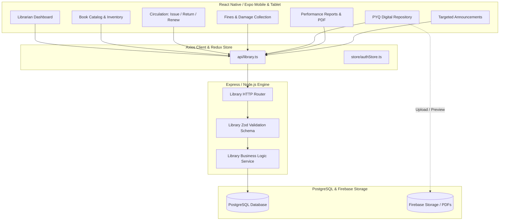

# Library Management System — Feature & Technical Design Document

## 1. Executive Summary

The **Library Management System (LMS)** is an enterprise module within the School ERP platform engineered for school librarians, administrators, educators, and students. It modernizes library workflows by providing end-to-end automation for book cataloging, circulation (issuance, returns, and renewals), automated overdue fine calculations, damage assessments with multi-channel payment collection, digital archives (Previous Year Question Papers - PYQs), role-targeted announcements, and institutional reporting.

---

## 2. Design System & UX Standards

The library feature adheres to a structured, institutional design language optimized for high data density, accessibility, and smooth touch interactions.

### 2.1 Color Palette
| Token | Hex Value | Usage |
| :--- | :--- | :--- |
| **Primary Accent** | `#D97706` | Primary action buttons, active states, focus highlights |
| **Secondary Accent** | `#B45309` / `#F59E0B` | Secondary badges, warm tones, emphasis highlights |
| **Accent Background** | `#FEF3C7` / `#FFFDF7` | Active card backgrounds, selected item badges |
| **Primary Dark Text** | `#171717` | Headings, primary labels, prominent values |
| **Body / Content Text**| `#334155` | Descriptions, list item text, readable body |
| **Muted / Subtext** | `#64748B` | Secondary metadata, dates, disabled labels |
| **Card / Surface Border** | `#E8E5DC` / `#E2E8F0` | Input borders, card outlines, table dividers |
| **Pull-to-Refresh** | `#000000` | Universal scroll refresh spinner color across all screens |
| **Success State** | `#026440` / `#DCFCE7` | Available copies, paid fines, completed loans |
| **Danger State** | `#DC2626` / `#FEF2F2` | Overdue loans, unpaid damage fines, delete actions |

### 2.2 Typography & Elevation
- **Font Families**: Inter-based design tokens (`FontFamily.bold`, `FontFamily.semiBold`, `FontFamily.medium`, `FontFamily.regular`).
- **Corner Radius**: Consistent `borderRadius: 5` across buttons, inputs, dropdowns, and modals for an institutional ERP look.
- **Micro-Interactions**: Active opacity transitions (`0.85`), non-jumping modals with animated backdrop fades, and instant feedback badges.
- **Scroll Refreshing**: Standardized `RefreshControl` with `colors={['#000000']}` and `tintColor="#000000"` on iOS and Android.

---

## 3. Architecture & Data Flow



---

## 4. Core Features & Functional Specification

### 4.1 Librarian Dashboard (`LibrarianDashboardView.tsx`)
- **Key Metrics (KPI Cards)**:
  - Total Books in Catalog & Available Inventory
  - Active Book Loans & Overdue Books Count
  - Total Fines Collected vs Pending Dues
- **Quick Action Bar**:
  - `Issue Book`: Quick-launch modal for student/teacher loan creation
  - `Return Book`: Fast copy barcode search & instant return
  - `Add Book`: Open 2-step catalog entry modal
  - `Collect Fine`: Launch guided 5-step damage fine assessment
  - `+ Add Announcement`: Create targeted broadcast
- **Circulation Alerts**: Real-time ticker for overdue loans requiring borrower contact.
- **Top Borrowed Books Ranking**: Visual leaderboard displaying high-demand titles.

---

### 4.2 Book Catalog & Inventory Management (`BooksView.tsx`, `BookDetailView.tsx`, `BookFormModal.tsx`)
- **Catalog Exploration**:
  - Search by Title, Author, ISBN, Barcode, or Rack Location.
  - Multi-filter chips: Category filter, Availability filter (All vs In Stock).
- **Book Details**:
  - Full metadata: Title, Author, ISBN, Publisher, Edition, Description, Category.
  - Physical Placement: Shelf Number, Rack Location, Floor.
  - Stock Allocation: Total copies, currently issued copies, available copies.
  - Borrowing History: Chronological record of past borrowers and loan durations.
- **Add / Edit Modal (`BookFormModal.tsx`)**:
  - Integrated Category creation directly inside the form.
  - Automatic ISBN and unique book copy ID generation.

---

### 4.3 Circulation Engine (`IssueBookView.tsx`)
- **Book Issuance Workflow**:
  1. **Member Lookup**: Search student by Roll No / Admission ID or teacher by Employee ID.
  2. **Book & Copy Selection**: Search book title or barcode with instant stock availability validation.
  3. **Loan Rules Application**: System verifies maximum active borrowing limits and restricts issuance if overdue dues exist.
  4. **Due Date Calculation**: Default 14-day loan duration with custom date override options.
- **Book Return & Renewal Workflow**:
  - Scan or select issued copy.
  - Automatic overdue days computation based on due date.
  - Automatic calculation of late fine (`Overdue Days × Daily Fine Rate`).
  - Option to renew book if no reservations are pending.

---

### 4.4 Fine Management & Collection (`FinesView.tsx`, `DamageFineModal.tsx`)
- **Dual Fine Categories**:
  1. **Overdue Fines**: Auto-accruing daily fines from late book returns.
  2. **Damage / Lost Book Fines**: Assessed fines for damaged bindings, torn pages, water damage, or lost copies.
- **Guided "Collect Fine" Modal (`DamageFineModal.tsx`)**:
  - **Step 1: Member Type & Select**: Student or Teacher selection with real-time directory search.
  - **Step 2: Book Selection**: Select the relevant book copy from currently or previously issued books.
  - **Step 3: Damage Assessment**: Select damage level (Minor, Moderate, Severe, Complete Replacement) and auto-fill recommended fine or enter custom amount.
  - **Step 4: Damage Description**: Add detailed notes and condition records.
  - **Step 5: Payment Mode**:
    - **Cash**: Direct in-counter collection with instant receipt generation.
    - **Online Pay**: Digital payment confirmation and transaction reference logging.
  - Multi-table transaction integrity: writes to both `damage_fines` and `payment_transactions`.

---

### 4.5 Previous Year Question Papers - PYQs (`PYQsView.tsx`)
- **Digital Archive**: Centralized question paper bank for students and faculty.
- **Taxonomy Filtering**:
  - Class / Grade (`Class 1` through `Class 12`)
  - Subject (`Mathematics`, `Science`, `Physics`, `English`, etc.)
  - Academic Year (`2020` – `2026`)
  - Examination Type (`Midterm`, `Final / Annual`, `Unit Test`, `Pre-Board`)
- **Document Management**:
  - Upload question paper PDF with metadata.
  - Integrated in-app viewer and secure direct download.

---

### 4.6 Analytics & Reports (`ReportsView.tsx`, `pdfGenerator.ts`)
- **Visual Analytics**:
  - Borrowing frequency over time.
  - Category demand distribution.
  - Overdue rate by class/department.
  - Revenue summary from fine collections.
- **Time Window Filter**:
  - `Today`, `This Week`, `This Month`, `This Term`, `This Academic Year`.
- **Export Engine**:
  - Generates comprehensive PDF reports branded with school header, date range, circulation tables, and revenue breakdown.

---

### 4.7 Targeted Announcements (`features/announcements/`)
- **Role Selection Dropdown**:
  - Options: `All` (Students & Teachers), `Student` (Students only), `Teacher` (Teachers only).
  - Clean text and description layout without icons for rapid input.
- **Duration Presets & Custom Fixer**:
  - Built-in date-range picker with mini calendar (`Start Date` to `End Date`).
  - Quick Presets: 3 Days, 7 Days, 14 Days, 30 Days.
  - Custom duration input in days.

---

### 4.8 Librarian Profile & Settings (`LibrarianProfileView.tsx`, `SettingsView.tsx`)
- **Profile Information**:
  - Staff Name, Librarian Code, Assigned Library Wing, Contact Number, Email.
  - Shift timings and operational hours.
- **Configuration & Policies**:
  - Maximum Books Per Student / Teacher.
  - Standard Loan Period (Default: 14 days).
  - Daily Overdue Fine Rate (e.g. ₹5/day).
  - Notification toggles for return reminders and fine alerts.

---

## 5. Database Schema Overview

```sql
-- Core Library Books Catalog
CREATE TABLE library_books (
    id UUID PRIMARY KEY DEFAULT gen_random_uuid(),
    institution_id UUID NOT NULL,
    title VARCHAR(255) NOT NULL,
    author VARCHAR(255) NOT NULL,
    isbn VARCHAR(50),
    barcode VARCHAR(100) UNIQUE,
    category_id UUID REFERENCES library_categories(id),
    publisher VARCHAR(255),
    edition VARCHAR(50),
    rack_location VARCHAR(100),
    shelf_number VARCHAR(50),
    total_copies INT DEFAULT 1,
    available_copies INT DEFAULT 1,
    created_at TIMESTAMP WITH TIME ZONE DEFAULT NOW(),
    updated_at TIMESTAMP WITH TIME ZONE DEFAULT NOW()
);

-- Book Loans & Circulation
CREATE TABLE library_loans (
    id UUID PRIMARY KEY DEFAULT gen_random_uuid(),
    institution_id UUID NOT NULL,
    book_id UUID REFERENCES library_books(id),
    borrower_type VARCHAR(20) NOT NULL, -- 'STUDENT' | 'TEACHER'
    borrower_id UUID NOT NULL,
    borrowed_at TIMESTAMP WITH TIME ZONE DEFAULT NOW(),
    due_date TIMESTAMP WITH TIME ZONE NOT NULL,
    returned_at TIMESTAMP WITH TIME ZONE,
    status VARCHAR(20) DEFAULT 'ACTIVE', -- 'ACTIVE' | 'RETURNED' | 'OVERDUE'
    fine_amount DECIMAL(10,2) DEFAULT 0.00,
    fine_paid BOOLEAN DEFAULT FALSE
);

-- Damage & Lost Book Fines
CREATE TABLE library_damage_fines (
    id UUID PRIMARY KEY DEFAULT gen_random_uuid(),
    institution_id UUID NOT NULL,
    book_id UUID REFERENCES library_books(id),
    borrower_type VARCHAR(20) NOT NULL,
    borrower_id UUID NOT NULL,
    damage_type VARCHAR(50) DEFAULT 'DAMAGE', -- 'PAGE_TORN' | 'BINDING' | 'WATER' | 'LOST' | 'OTHER'
    damage_notes TEXT,
    fine_amount DECIMAL(10,2) NOT NULL,
    is_paid BOOLEAN DEFAULT FALSE,
    payment_method VARCHAR(20), -- 'CASH' | 'ONLINE'
    created_at TIMESTAMP WITH TIME ZONE DEFAULT NOW()
);

-- Payment Transactions
CREATE TABLE library_payment_transactions (
    id UUID PRIMARY KEY DEFAULT gen_random_uuid(),
    institution_id UUID NOT NULL,
    fine_id UUID REFERENCES library_damage_fines(id),
    amount DECIMAL(10,2) NOT NULL,
    payment_method VARCHAR(20) NOT NULL, -- 'CASH' | 'ONLINE'
    transaction_ref VARCHAR(100),
    created_at TIMESTAMP WITH TIME ZONE DEFAULT NOW()
);

-- Previous Year Questions (PYQs)
CREATE TABLE library_pyqs (
    id UUID PRIMARY KEY DEFAULT gen_random_uuid(),
    institution_id UUID NOT NULL,
    title VARCHAR(255) NOT NULL,
    class_id VARCHAR(50) NOT NULL,
    subject VARCHAR(100) NOT NULL,
    year INT NOT NULL,
    exam_type VARCHAR(50) NOT NULL, -- 'MIDTERM' | 'FINAL' | 'UNIT_TEST'
    file_url TEXT NOT NULL,
    created_at TIMESTAMP WITH TIME ZONE DEFAULT NOW()
);
```

---

## 6. Security, Permissions & Validation

1. **Role-Based Access Control (RBAC)**:
   - Only authenticated users with role `LIBRARIAN` or `INSTITUTION_ADMIN` can access library operational APIs (`POST/PUT/DELETE`).
   - Teachers and Students receive read-only catalog access and personal loan history views.
2. **Server-Side Validation (Zod)**:
   - All mutation endpoints enforce strict Zod schemas (`CreateDamageFineSchema`, `IssueBookSchema`, `ReturnBookSchema`, `CreateBookSchema`).
   - Missing optional parameters gracefully default without returning validation failures.
3. **Multi-Tenancy Isolation**:
   - All queries filter strictly by `institution_id` derived from the verified JWT bearer session.
