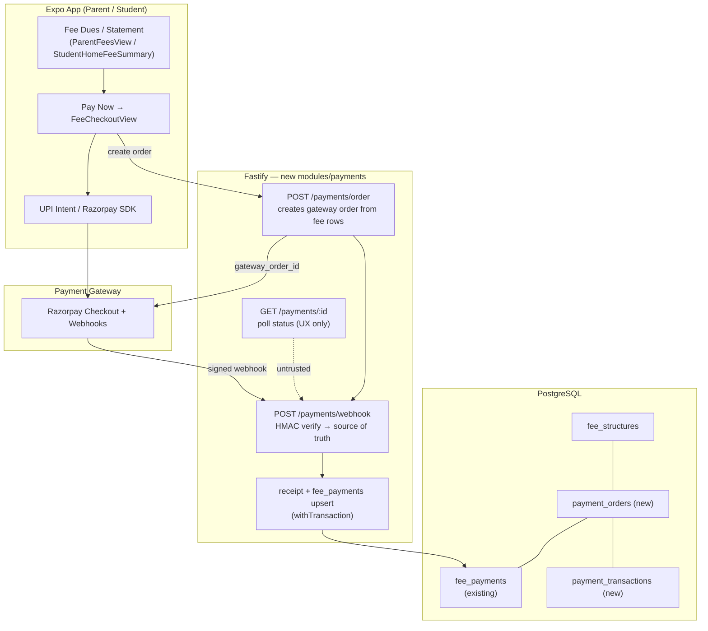

# Payments Integration — Online Fee Collection (Design for Later)

> Status: **DESIGN ONLY — not implemented.** Fees currently settle offline ("pay at school").
> Goal: Zomato/Swiggy-style online payment for school fees — UPI intent, cards, netbanking, wallets — with server-side truth only.
> Created: 2026-09-23 · Companion to `DEFERRED.md` (payment gateway = deferred item, this is the build plan).

---

## 1. Current State (honest)

| Area | Today |
|---|---|
| Fee structures / list / dues | ✅ Real (`fee_structures`, accountant → `GET /fees`) |
| Fee payments (record) | ✅ Real (`fee_payments`, accountant collects → API) |
| Parent / student statements | ✅ Real (`GET /fees/parent`, `GET /fees/student`) |
| Online payment | ❌ None — parent/student UI shows **"Pay at school accounts office"** |
| Receipts | ⚠️ Receipt No generated server-side for manual collections; client-side fake `REC-2026-####` still exists in local `addIncome` (remove when building this) |
| Webhooks / refunds / settlement | ❌ None |

**Implication:** revenue path is 100% cash/UPI-handled offline by the accountant. This plan turns the **parent's phone** into the payment terminal (like Zomato/Swiggy), so money lands in the school's account and `fee_payments.status='paid'` is written **by the server after gateway confirmation**, never by the client.

---

## 2. How Zomato / Swiggy Actually Do It (analysis)

### UX flow users expect
```
Cart (= pending dues)
  → Choose payment method (UPI / Card / Netbanking / Wallet / Pay-later)
  → App opens UPI intent (GPay/PhonePe/Paytm) OR hosted card sheet
  → User approves in bank app
  → App returns with "success" spinner
  → Backend receives webhook (authoritative) → order marked paid
  → UI updates receipt/order
```

### Technical patterns we must copy
1. **Server creates the order** — amount, currency, order_id come from DB (parent cannot tamper price).
2. **Gateway order created server-side** (`POST` to Razorpay/Cashfree with amount in paise).
3. **Client only gets a `payment_session_id` / order id** — never calculates money.
4. **UPI intent / checkout SDK on mobile** — no card details ever touch our servers (PCI SAQ-A / P2PE via gateway).
5. **Two-phase confirmation:**
   - Client redirect (fast UX, **untrusted**)
   - **Webhook (HMAC signature verified) = source of truth** → only webhook flips `fee_payments` to `paid`.
6. **Idempotent webhook** — retry-safe (`event_id` unique, status transitions guarded).
7. **Failure + timeout states** — "pending", "failed", "expired order", "already paid", reconciliation job.
8. **Post-payment:** receipt + statement refresh (already have statement endpoints).

### Where a school ERP differs from food delivery
| | Zomato/Swiggy | School fees |
|---|---|---|
| Order lifetime | Minutes | Days/weeks (due date) → need **order expiry** + partial payment option later |
| Amount | Cart total | Fee structure rows (term-wise); may pay **one fee line** or **all dues** |
| Refunds | High volume | Rare (refund on cancellation of admission) → Phase 2 |
| Settlement | Daily | Same gateway settlement; school finance still uses accountant panel for reconciliation |
| Who pays | Same user | Parent on linked student (session-scoped, like existing `linkedStudentUSN`) |
| Compliance | Standard | Fee amount must match `fee_structures.amount` ± explicit multi-fee selection |

---

## 3. Gateway Options (India)

| Gateway | UPI Intent (mobile) | Cards | NB | Wallets | Webhooks | Pricing (indicative) | Notes |
|---|---|---|---|---|---|---|---|
| **Razorpay** ✅ recommended | ✅ strong | ✅ | ✅ | ✅ | ✅ HMAC | ~2% (UPI often 0%–low) | Best docs, school fee examples, test mode, Android intent flow, refunds API |
| Cashfree | ✅ | ✅ | ✅ | ✅ | ✅ | ~1.75% / UPI low | Cheaper; good for high volume |
| PhonePe PG | ✅ UPI-first | ✅ | ✅ | ✅ PhonePe | ✅ | ~2% | UPI heavy audience |
| PayU | ✅ | ✅ | ✅ | ✅ | ✅ | ~2% | Legacy but fine |
| Paytm PG | ✅ | ✅ | ✅ | ✅ Paytm | ✅ | ~2% | Wallet + UPI |
| Stripe | ✅ | ✅ | ❌ India NB weak | ❌ | ✅ | ~2% + FX | Better for international; not ideal for domestic school fees |

**Decision: Razorpay for MVP** (drop-in `Checkout` + UPI intent, mature webhooks, easy KYC, ₹0 UPI intent cost on many plans). Gateway chosen behind an **adapter interface** so Cashfree/PhonePe can be swapped later.

**Why adapter matters:** all payment logic behind `PaymentGateway` interface — `createOrder()`, `verifyWebhook()`, `refund()`, `fetchStatus()`. Razorpay is impl #1.

---

## 4. Target Architecture



### Trust rules (non-negotiable)
1. **Webhook + server-side signature verify = only path to `paid`.**
2. Client `success` callback → only shows spinner; UI refresh waits for webhook (or signed status poll).
3. Amount always re-derived from `fee_structures` on server at order creation.
4. Parent pays only for **own linked student** (reuse `scope.linkedStudentUSN` resolution — same as `GET /fees/parent`).
5. Webhook endpoint: **no Firebase auth** (gateway IP/signature only), rate-limited, signature mandatory.
6. Idempotency: `gateway_event_id UNIQUE`; re-delivery returns 200 without double-crediting.

---

## 5. Database Design (additions)

```text
payment_orders
  id                  text PK            po_<ts>_<rand>
  institution_code    varchar FK
  student_id          text FK            -- resolved server-side
  parent_uid          text               -- payer (session)
  currency            varchar default 'INR'
  amount_paise        bigint             -- ALWAYS integer paise from server calc
  status              varchar            -- created | authorized | paid | failed | expired | refunded | partially_refunded
  gateway             varchar            -- 'razorpay'
  gateway_order_id    text UK
  gateway_payment_id  text               -- on success
  signature           text               -- webhook signature (audit)
  fee_structure_ids   jsonb              -- ['fs_1','fs_2'] what this order covers
  expires_at          timestamp          -- default now + 24h (fee intent) or session TTL
  webhook_event_id    text UK            -- last processed event (idempotency)
  paid_at             timestamp
  raw_callback        jsonb              -- audit dump
  created_at / updated_at

payment_transactions            -- one row per attempt (audit + reconciliation)
  id, payment_order_id FK, gateway, gateway_attempt_id,
  amount_paise, method (upi|card|netbanking|wallet),
  status (initiated|success|failure), failure_code, failure_reason,
  created_at
```

### Changes to existing `fee_payments`
- Add nullable `payment_order_id` FK + `gateway_payment_id`.
- `created_by`: `'system:webhook'` when written by webhook (vs accountant uid for manual).
- Manual accountant collection **stays allowed** (offline cash still happens) — both paths meet at same table.

### Receipt numbering
- Single source: server sequence or `REC-<yyyymm>-<seq>` **inside `withTransaction`** on paid → fix existing local `REC-2026-####` generator.

---

## 6. API Contract

| Method | Path | Auth | Purpose |
|---|---|---|---|
| POST | `/api/v1/payments/order` | parent (or student self) | Body: `{ feeStructureIds: string[] }` → validates ownership + amounts → creates `payment_orders` + gateway order → returns `{ orderId, gatewayOrderId, keyId, amountPaise }` |
| GET | `/api/v1/payments/:orderId` | parent (own order) | UX poll: order status |
| POST | `/api/v1/payments/webhook` | **signature only** | Razorpay events → mark paid/failed |
| GET | `/api/v1/payments/orders` | accountant/admin | Reconciliation list |
| POST | `/api/v1/payments/:orderId/refund` | admin | Phase 2 |

### Order creation (server logic)
```
session.uid (parent)
  → resolve linkedStudentUSN → student.id          (same as getParentFees)
  → load fee_structures WHERE id IN body AND institution = session
  → amount = sum(active, class-eligible, unpaid fees)
  → insert payment_orders (amount_paise, expires_at)
  → gateway.createOrder(amount, receipt=orderId, notes={orderId, studentId})
  → return client token payload
```

### Webhook (Razorpay)
```
verify HMAC-SHA256(body, WEBHOOK_SECRET) == x-razorpay-signature
parse event_id (idempotency)
payment.captured / payment.failed
  → withTransaction:
       update payment_orders → paid | failed
       for each fee_structure_id in order:
         upsert fee_payments (status=paid, amount, paymentMethod=upi/card, receiptNo, paid_at)
  → 200 (fast; do heavy work inside tx only)
```

---

## 7. Client UX (Expo)

### New screens (Phase 1)
1. **`FeeCheckoutView`** — amount breakdown of selected dues, method chips (UPI / Card / Netbanking), "Pay ₹X" button.
2. **Method sheet** — UPI apps deep-link (`upi://pay?pa=...&pn=...&am=...&tr=<order>`) **or** Razorpay `Checkout` via official RN SDK / RN WebView.

### Flow
```
ParentFeesView → [Pay Now on a due line | Pay all dues]
  → POST /payments/order { feeStructureIds }
  → open checkout (UPI intent / card sheet)
  → return to app → "Confirming payment…" (poll GET /payments/:id every 3s, max ~60s)
  → webhook lands → status=paid → refresh statement (existing loadFees)
  → Receipt modal (existing)
```

### States to design
`processing`, `success`, `failed (reason)`, `timeout → check status`, `already paid (idempotent)`, `order expired`, `network offline`.

**Never** mark UI paid solely from SDK callback.

---

## 8. Security Checklist

- [ ] Webhook HMAC verification with secret from env (not in repo)
- [ ] Amount computed server-side only; never accept `amount` from client
- [ ] Student ownership from session (`scope.linkedStudentUSN`), never from body
- [ ] `payment_orders` tenant-scoped (`institution_code` on every query)
- [ ] Order expiry enforced before creating gateway order
- [ ] Idempotent webhook (unique `webhook_event_id`)
- [ ] No card data on our servers (gateway-hosted) → PCI **SAQ-A**
- [ ] Rate-limit order creation (e.g. 10/min/user)
- [ ] Signature + raw body preserved (Fastify: keep raw buffer for verify)
- [ ] Refunds admin-only + logged
- [ ] Audit `raw_callback` jsonb retained (PII-minimized)
- [ ] Test mode keys only until UAT sign-off

---

## 9. Costs & Compliance (indicative)

| Item | Note |
|---|---|
| Setup | ₹0 for standard PG (KYC + business docs) |
| UPI intent | Often ~0% / free tier — **default Indian method** |
| Cards / NB | ~1.75–2% per txn |
| Payout | T+1 to school bank (gateway settlement) |
| Docs needed | PAN, bank account, business proof (trust/society/school) |
| Fee receipt | Gateway receipt ≠ school receipt; we still issue our `receipt_no` |
| TDS/GST on fees | Accounting concern — gateway provides settlement report CSV |

---

## 10. Phased Roadmap

### Phase 0 — Prep (no code) ✅ decision gate
- [ ] Register Razorpay (or chosen PG) merchant + KYC
- [ ] Decide: parent-only pay, or student self-pay too
- [ ] Decide policy: partial payment of selected fee lines? (recommend **yes, per fee line**)
- [ ] Env: `PAYMENT_GATEWAY`, `PAYMENT_KEY_ID`, `PAYMENT_KEY_SECRET`, `PAYMENT_WEBHOOK_SECRET`

### Phase 1 — MVP (online pay → paid receipt)
1. `modules/payments` routes/controller/service + `PaymentGateway` adapter (Razorpay)
2. Tables `payment_orders`, `payment_transactions`; `fee_payments.payment_order_id`
3. Webhook handler + signature verify + **`withTransaction`** upsert to `fee_payments`
4. `POST /payments/order` (parent + student self)
5. Client: `FeeCheckoutView` + UPI intent/Checkout; wire **Pay Now** into `ParentFeesView` + `StudentHomeFeeSummary` (replace "pay at school" as default, keep it as fallback method)
6. Remove local fake `REC-2026-####` generator (single receipt source)
7. Tests: signature verify, amount calc, ownership 403, idempotent webhook, order expiry
8. Razorpay **test mode** (test UPI `success@razorpay`, test cards)

### Phase 2 — Finance ops
- Accountant "Online payments" reconciliation tab (`GET /payments/orders`)
- Settlement CSV import vs `fee_payments`
- Refunds (admin) + reverse `fee_payments`
- Auto receipt PDF (was deferred — can hang off paid webhook)

### Phase 3 — Growth (optional)
- Partial payments / installment plans (fee `terms` already exist)
- SMS/WhatsApp payment reminder with deep link to order
- Multiple gateways (Cashfree fallback) via adapter
- Pay-later / EMI partners

### Explicitly still deferred (see `DEFERRED.md`)
- SMS reminders, PDF receipts (until Phase 2/3)
- Expense/fleet backend (unrelated)

---

## 11. Testing Plan

| Layer | Tests |
|---|---|
| Unit | amount → paise calc; class-eligible fee filter; webhook signature valid/invalid; idempotency |
| Service | order create (parent of student ✅, stranger parent 403); expiry; already-paid order re-pay |
| Integration | webhook `payment.captured` → `fee_payments` row paid + statement shows paid |
| E2E (manual) | Razorpay test mode: UPI intent success / failure / cancel; app poll timeout recovery |
| Chaos | webhook arrives before client returns; webhook retries ×3; duplicate event_id |

---

## 12. File Touch Map (when implementation starts)

```
server/
  src/modules/payments/
    payment.routes.ts | payment.controller.ts | payment.service.ts
    gateway/adapter.ts | gateway/razorpay.ts
  src/modules/shared/db/schema.ts     (+ payment_orders, payment_transactions)
  src/modules/admin/admin.service.ts  (statement joins payment_order status)
  .env                                 (+ payment keys — NEVER commit)
client/
  api/payments.ts
  features/parent/components/FeeCheckoutView.tsx
  features/student/ (shared checkout component)
  ParentFeesView.tsx / StudentHomeFeeSummary.tsx   (Pay Now → checkout)
  features/accountant/ (reconciliation view Phase 2)
tests/
  webhookSignature.test.ts | paymentService.test.ts
```

---

## 13. Success Criteria (MVP done when)

1. Parent pays ₹ fee via UPI intent from phone → returns to app → dues show **PAID** without accountant touching anything.
2. Client kill during payment → reopen → status still correct (webhook truth).
3. Webhook replay → no double payment records.
4. Accountant panel shows same payment (realtime statement).
5. `fee_payments` only written with `institution_code` from session + `withTransaction`.
6. Razorpay dashboard txn ↔ our `payment_orders` reconcilable 1:1.

---

## 14. Open Decisions (answer before Phase 1)

1. **Gateway:** Razorpay (recommended) vs Cashfree (cheaper)?
2. **Who can pay:** linked parent only, or student self too? (code supports both)
3. **Split payment:** pay one fee line vs entire due balance? (recommend: selectable lines)
4. **Convenience fee:** absorb ~2% or pass to parent? (school policy)
5. **Order expiry:** 24h vs due-date-aligned?
6. **Fallback:** keep "pay at school" as secondary method? (recommend: yes, toggle)

---

*Implement later under a dedicated task: "Phase 1 — Razorpay MVP". Do not start until merchant KYC is done (keys exist) and decisions above are closed.*


---

## 15. Implementation Status (updated 2026-10-15)

> Status: **IMPLEMENTED (Phases 1 + 2) — test-mode only.** All items below are live in the
> codebase. Design sections 1-14 are historical context; this section is the current truth.

### Shipped
- **Per-tenant merchant accounts** stored encrypted in DB (`payment_configs`, AES-256-GCM via
  `PAYMENT_CONFIG_MASTER_KEY`). Admin UI: **Payment Settings** tab (write-only secrets, live/test
  webhook URL copy). Server config schema accepts omitted secrets (keep-stored on re-save).
- **Order + webhook + refunds** (`server/src/modules/payments/`): Razorpay adapter, HMAC-SHA256
  signature verify, idempotent webhook (`webhook_event_id` unique), `SELECT ... FOR UPDATE` +
  guarded status transitions inside `withTransaction`, monthly receipt sequence `REC-YYYYMM-####`.
- **Client checkout**: `FeeCheckoutView` wired into `ParentFeesView` + `StudentHomeFeeSummary`.
  Client NEVER marks paid from the SDK callback — it polls `GET /payments/:id`; the webhook is the
  only path to `paid`.
- **Accountant reconciliation** tab (`OnlinePaymentsView`) + admin-only refunds.
- Fake client-side `REC-2026-####` receipt generator removed from `useFinanceStore`.
- **Tests**: 131 payments/encryption tests (full suite 274/274 green). `npm run build` clean.

### Explicitly still deferred
- Settlement CSV import, SMS/WhatsApp reminders, auto receipt PDF, installment plans (Phase 3).

### Test-mode E2E runbook
1. Start API: `cd server && npm run dev` (needs Postgres + `.env` with `PAYMENT_CONFIG_MASTER_KEY`).
2. Expose webhook: `ngrok http <api-port>` → copy the https URL.
3. Admin → **Payment Settings**: enter Razorpay **test** key_id/key_secret + webhook secret,
   paste ngrok URL as webhook, enable.
4. Parent app → Fees → **Pay** → choose lines → Razorpay test sheet
   (UPI `success@razorpay`, or test card). Webhook should flip order to `paid` and issue a receipt.
5. Verify idempotency: replay the webhook — order must stay credited once.

### Verification (this pass)
- server: `npm test` 274/274, `npm run build` clean
- client: `npx tsc --noEmit` clean, `npm run lint` clean (0 errors / 0 warnings)
