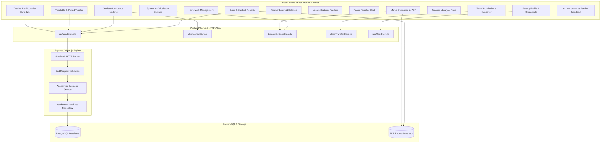

# Teacher Management System — Feature & Technical Design Document

## 1. Executive Summary

The **Teacher Management System (TMS)** is a core operational module within the School ERP platform engineered for educators, class teachers, subject faculty, and academic coordinators. It digitizes daily classroom operations, student attendance logging, curriculum delivery, grade assessments, homework dissemination, faculty leave tracking, parent-teacher messaging, real-time student location monitoring, institutional reporting, and class substitution handovers.

---

## 2. Design System & UX Standards

The Teacher portal adheres to an institutional design language characterized by high data clarity, clean typography, standardized touch targets, and consistent visual polish.

### 2.1 Color Palette
| Token | Hex Value | Usage |
| :--- | :--- | :--- |
| **Primary Brand Gold** | `#F4C430` | Active tab highlights, badge highlights, brand identity |
| **Accent Amber** | `#D97706` / `#B45309` | Warning badges, pending status, active dropdown states |
| **Primary Dark Text** | `#111827` / `#171717` | Screen headers, student names, KPI values |
| **Body / Content Text**| `#374151` / `#4B5563` | Descriptions, period timings, metadata labels |
| **Muted / Subtext** | `#6B7280` / `#9CA3AF` | Supporting details, timestamps, input placeholders |
| **Card / Surface Border**| `#E8E5DC` / `#E5E7EB` | Card containers, input outlines, table dividers |
| **Surface Background** | `#FFFFFF` | Card surfaces, modals, popovers |
| **App Canvas** | `#F9FAFB` | Main screen background |
| **Pull-to-Refresh** | `#000000` | Universal scroll refresh spinner across all teacher views |
| **Success State** | `#026440` / `#DCFCE7` | Present attendance, approved leaves, passing marks |
| **Danger State** | `#DC2626` / `#FEE2E2` | Absent attendance, rejected leaves, failing scores |
| **Late / Pending State**| `#B45309` / `#FEF3C7` | Late arrivals, pending leave requests, unsubmitted slots |

### 2.2 Typography & Elevation
- **Font Families**: Inter-based typeface tokens via `FontFamily.extrabold`, `FontFamily.bold`, `FontFamily.medium`, and `FontFamily.regular`.
- **Corner Radius**: Standardized `borderRadius: 5` applied systematically across cards, buttons, inputs, modals, filter chips, and skeleton placeholders.
- **Clean Badging & Typography**: Status indicators and tags (e.g. `Casual Leave · 1 Day`, `Pending`, `Approved`) utilize crisp typography without heavy background boxes for an uncluttered layout.
- **Scroll Refreshing**: Uniform `RefreshControl` implementation on all scrollable views with `colors={['#000000']}` and `tintColor="#000000"`.
- **Skeleton & Shimmer Standards**: Dedicated layout-accurate skeleton loaders powered by `TeacherShimmerSkeleton` with automatic pulse loop fallback.

---

## 3. Architecture & Data Flow



---

## 4. Core Features & Functional Specification

### 4.1 Teacher Dashboard (`app/(teacher)/home.tsx`)
- **Top Greeting & Header**:
  - Greeting display: `Hello, [Full Name]`.
  - Notification icon with badge counter linking to institution announcements.
  - Hamburger menu trigger for the quick-navigation drawer.
- **Today's Time Table Card (`TeacherHomePeriodsList.tsx`)**:
  - Chronological period listing showing Period number, Subject, Timing, and Class Section.
  - Interactive "Mark Attendance" / "View Attendance" button per period.
  - Substitution badge indicating whether a period is covered by or transferred to another faculty.
  - "View Full" link navigating to the complete weekly timetable.
- **Today's Progress Card (`TeacherDonutCard.tsx`)**:
  - Dual animated SVG circular donut meters:
    1. **Completed Periods Ring**: Ratio of completed lectures vs total daily periods.
    2. **Attendance Marked Ring**: Ratio of marked class rosters vs total sessions.
  - Percentage metric readout and real-time status summary.
- **Weekly Overview Chart (`TeacherWeeklyBarCard.tsx`)**:
  - 5-day lecture load bar chart (Monday to Friday) visualizing assigned periods.
  - Dynamic highlight on today's bar column.
- **Floating Pill Bottom Navigation**:
  - Compact rounded tab bar with quick access to: `Home`, `Schedule`, `Attendance`, `Marks`, and `Profile`.

---

### 4.2 Timetable & Schedule Engine (`TeacherTimetableView.tsx`, `ClassTeacherTimetableBuilder.tsx`)
- **Day-by-Day Calendar Strip**:
  - Horizontal day selector displaying Day name, Date number, and active selection indicator.
- **Period Cards**:
  - Detailed card per slot with Start/End times, Subject title, Class & Section.
  - Direct action button to initiate attendance marking.
  - Transfer Period button allowing faculty to initiate substitution handovers.
- **Class Teacher Timetable Builder (`ClassTeacherTimetableBuilder.tsx`)**:
  - Class teachers can construct, edit, and version weekly timetables for their designated class section.
  - Slot configuration with subject assignments, room allocations, and period timings.
  - Version increments with historical schedule preservation.

---

### 4.3 Student Attendance Marking Engine (`AttendanceMarkingView.tsx`)
- **Period & Class Header**:
  - Context banner displaying Class Section, Subject, Date, and current period timing.
- **Summary Metrics**:
  - Real-time counters: Total Students, Present Count, Absent Count, Late Count, and Attendance Percentage.
- **Batch Actions**:
  - `Mark All Present`: Instant one-tap roll call initialization.
  - `Mark All Absent` / `Reset`: Reset or clear current marking session.
- **Student Roster List**:
  - Student card displaying avatar, Roll Number / USN, Student Name, and historical attendance rate.
  - 3-Way Status Toggle:
    - **Present**: Green highlight (`#026440`).
    - **Absent**: Red highlight (`#DC2626`).
    - **Late**: Amber highlight (`#B45309`).
  - Remarks input field for excusal reasons or parent notes.
- **Search & Quick Filters**:
  - Real-time search filter by student name or roll number.
  - Filter chips: `All`, `Present`, `Absent`, `Late`.
- **Submission & Store Synchronization**:
  - Saves records via `api/academics.ts` and updates local `attendanceStore.ts` for offline resiliency.

---

### 4.4 Examination & Marks Assessment Engine (`TeacherMarksView.tsx`, `marksCardPdfGenerator.ts`)
- **Exam Type & Class Filters**:
  - Multi-select chips for Exam Types: `Unit Test 1`, `Unit Test 2`, `Midterm Exam`, `Final Exam`, and custom exams configured in Settings.
  - Class and Subject dropdown selectors.
- **Class Performance Analytics**:
  - Class Average Marks, Highest Marks, Lowest Marks, and Overall Passing Rate.
- **Student Marks Table**:
  - Roll No, Student Name, Marks Input (numeric with max-marks validation), Calculated Percentage, and Dynamic Grade (`A+`, `A`, `B`, `C`, `F`).
  - Status Indicator: Automatic `PASS` or `FAIL` calculation matching configurable system rules.
- **Batch Operations**:
  - Instant auto-save to local and remote storage.
  - Batch entry with keyboard next-field progression.
- **Marks Card PDF Generator (`marksCardPdfGenerator.ts`)**:
  - Generates institutional marks reports branded with school emblem, grade boundaries, student rankings, and teacher signature blocks.

---

### 4.5 Homework & Assignment Management (`TeacherHomeworkView.tsx`)
- **Assignment Feeds & Filtering**:
  - Status tabs: `Active / Ongoing`, `Completed / Graded`, `Drafts`.
  - Filter by Class, Section, and Subject.
- **Homework Cards**:
  - Subject tag, Assignment Title, Due Date, Total Submissions counter (`Submitted / Total Students`).
  - Expandable task description, attached reference links, or instructions.
- **Create Homework Modal**:
  - Class & Subject selector.
  - Title and detailed multi-line instructions.
  - Submission deadline date picker.
  - Optional maximum points / grading scheme.
- **Student Submission Tracker**:
  - Roster review showing submission timestamp, attached work status, grading input, and feedback notes.

---

### 4.6 Class Substitution & Transfer Handover (`ClassTransferModal.tsx`, `classTransferStore.ts`)
- **Handover Workflow**:
  - Faculty can delegate a specific period to a colleague due to meetings, emergency leave, or training.
  - Selection of target substitute teacher from the faculty directory.
  - Handover notes, lesson plan instructions, and expected syllabus coverage.
- **Recipient Acceptance & Dashboard Alert**:
  - Receiving faculty receives an in-app substitution request card with `Accept` or `Decline` actions.
  - Accepted periods dynamically merge into the covering teacher's "Today's Schedule" with `Covering for [Teacher Name]` badges.

---

### 4.7 Faculty Leave & Attendance Tracking (`TeacherLeaveView.tsx`, `TeacherAttendanceView.tsx`)
- **Leave Balances**:
  - Balance cards displaying available and total quota for:
    - **Casual Leave**: e.g., 8 of 12 days left.
    - **Sick Leave**: e.g., 6 of 10 days left.
    - **Earned Leave**: e.g., 14 of 15 days left.
- **Application History & Clean Badging**:
  - Filter tabs: `All`, `Pending`, `Approved`, `Rejected`.
  - Leave cards with streamlined typography: `Casual Leave · 1 Day`, clean `Pending` / `Approved` text without cluttering background boxes.
  - Date ranges, reason summary, and application date metadata.
- **Apply Leave Modal**:
  - Leave type selector with balance preview.
  - Dropdown calendar date picker for Start Date and Optional End Date.
  - Automatic duration computation (working days exclusion).
  - Reason text area with submission validation.
- **Faculty Self Attendance Log (`TeacherAttendanceView.tsx`)**:
  - Monthly working day logs with Check-In, Check-Out, Net Hours, and Status (`Present`, `Late`, `On Leave`, `Holiday`).

---

### 4.8 Student Locator & Security Monitoring (`TeacherLocateStudentsView.tsx`)
- **Locate Directory**:
  - Real-time search by Student Name or USN.
  - Class chips filter: `All`, `Class 6 A`, `Class 6 B`, etc.
- **Presence Summary**:
  - Quick count badges: Present, Absent, and Late students.
- **Student Locator Cards**:
  - Student avatar, name, USN, Class & Section.
  - Real-time presence status and "Last Seen" timestamp (e.g., `8:30 AM`).
  - Quick Contact Action Buttons:
    - **Call Parent**: Direct telephone launcher for immediate guardian contact.
    - **Chat / Message**: Direct link to guardian conversation thread.

---

### 4.9 Parent-Teacher Direct Communication (`TeacherChatView.tsx`)
- **Parent Conversation Directory**:
  - List of student guardians with child reference (e.g. `Priya Sharma • Parent of Aarav Sharma`).
  - Latest message preview, unread indicator, and timestamp.
  - Pull-to-refresh with black spinner and shimmer skeleton.
- **Interactive Chat Interface**:
  - Header with parent contact name, student association, and phone shortcut.
  - Message thread with incoming (parent) and outgoing (teacher) chat bubbles.
  - Real-time message composer with send trigger.

---

### 4.10 Analytics & Comprehensive Academic Reports (`TeacherReportsView.tsx`, `AttendanceStudentReport.tsx`, `ClassAttendanceReport.tsx`)
- **Report Types**:
  - `Class Attendance Report`: Attendance aggregates, daily trend graph, and subject attendance breakdown.
  - `Student Attendance Report`: Granular individual attendance profiles, percentage distribution, and absence patterns.
  - `Marks Analysis Report`: Grade distribution charts, toppers list, and low-performance intervention alerts.
- **Date Range Filters**:
  - `Current Month`, `Last 30 Days`, `Full Academic Term`, or custom dates.
- **PDF Report Engine (`attendancePdfGenerator.ts`)**:
  - Generates institutional PDF reports formatted with institutional header, summary metrics, student tables, trend charts, and signature blocks.

---

### 4.11 Teacher Library Circulation (`TeacherLibraryView.tsx`)
- **Dual Section Switcher**:
  - **Received Books**: Books currently borrowed by the faculty member.
    - Accession number, title, author, issue date, due date, renewal count.
    - One-tap "Renewal" request trigger.
  - **Library Fines**: Overdue or damage penalty ledger.
    - Fine ID, reason, assessment date, payment status (`PAID` vs `UNPAID`).
    - Interactive "Pay Fine" modal and instant "View Receipt" modal.
- **Clean Typography**: Fine records and book details display clean typography without heavy background boxes.

---

### 4.12 Targeted Announcements Broadcast (`features/announcements/`, `CreateAnnouncementModal.tsx`)
- **Multi-Role Audience Targeting**:
  - Role selection: `All` (Students & Teachers), `Student` (Students only), `Teacher` (Teachers only).
  - Streamlined trigger and description layout without visual clutter.
- **Time Period & Duration Fixer**:
  - Start Date and End Date dropdown calendar pickers.
  - Duration presets: `3 Days`, `7 Days`, `14 Days`, `30 Days`.
  - "Fix Custom Duration" numeric day fixer.

---

### 4.13 Faculty Profile Management (`TeacherProfileView.tsx`, `TeacherCompleteProfileForm.tsx`)
- **Hero Profile Card**:
  - Circular avatar with photo change picker (`expo-image-picker`) and verified badge.
  - Full Name, Designation, Department, Employee Code.
- **Personal & Professional Credentials**:
  - Contact Number, Email Address, Highest Qualification, Total Teaching Experience.
- **Institution Overview**:
  - Institution Name, School/College Code, and Institution Type (`School` vs `College`).
- **Profile Edit & Persistence**:
  - In-place editing mode with client validation and save synchronization via `/users/complete-profile`.
- **Sign Out**:
  - Secure Firebase and store session cleanup.

---

### 4.14 System Calculation & Evaluation Configuration (`TeacherSettingsView.tsx`, `teacherSettingsStore.ts`)
- **Exam Types Configuration**:
  - Manage periodic, term, and cumulative exams.
  - Configurable maximum marks per exam (`25`, `50`, `100`, or custom).
  - Add and delete custom exam categories.
- **List Types Configuration**:
  - Enable/disable list categories (Classwork, Homework, Quizzes, Projects).
  - Toggle switches and editable maximum marks per list type.
- **Passing Threshold Rules**:
  - Dual threshold modes:
    - **Marks**: Fixed passing score (e.g., 35 Marks or 40 Marks).
    - **Percentage**: Fixed passing percentage (e.g., 35% or 40%).
  - Real-time persistence via Zustand `useTeacherSettingsStore`.

---

### 4.15 Shimmering Skeleton Loader Framework (`features/teacher/components/skeletons/`)
- Comprehensive layout-accurate shimmering skeletons matching exact UI layouts:
  1. `TeacherHomeSkeleton`: Greeting, period rows, 2 donuts, bar chart.
  2. `TeacherTimetableSkeleton`: Day chips strip and period cards.
  3. `TeacherAttendanceSkeleton`: KPI cards, filter bar, student rows with toggle shapes.
  4. `TeacherMarksSkeleton`: Exam chips, statistics block, marks table rows.
  5. `TeacherHomeworkSkeleton`: Filter pills, card description and submission counters.
  6. `TeacherLeaveSkeleton`: Balance cards, summary metrics, request cards.
  7. `TeacherReportsSkeleton`: Tab headers, search box, class card tiles.
  8. `TeacherLibrarySkeleton`: Block switcher, search bar, book cards.
  9. `TeacherChatSkeleton`: Search bar, conversation avatar and preview rows.
  10. `TeacherLocateSkeleton`: Search input, class chips, student status cards.
  11. `TeacherProfileSkeleton`: Avatar circle, info card rows, assignment chips.
  12. `TeacherSettingsSkeleton`: Exam cards, toggle switch rows, threshold input box.

---

## 5. Database Schema Overview

```sql
-- Timetables (Master Header)
CREATE TABLE timetables (
    id TEXT PRIMARY KEY, -- Prefix 'tt_'
    institution_code VARCHAR(100) NOT NULL,
    class_section_id TEXT NOT NULL,
    academic_year VARCHAR(100) DEFAULT '',
    term VARCHAR(100) DEFAULT '',
    version INT NOT NULL DEFAULT 1,
    effective_from DATE NOT NULL,
    created_by TEXT NOT NULL,
    created_at TIMESTAMP WITH TIME ZONE DEFAULT NOW(),
    updated_at TIMESTAMP WITH TIME ZONE DEFAULT NOW(),
    CONSTRAINT uq_timetables_class_version UNIQUE (class_section_id, version)
);

-- Timetable Period Slots
CREATE TABLE timetable_slots (
    id TEXT PRIMARY KEY, -- Prefix 'ts_'
    timetable_id TEXT NOT NULL REFERENCES timetables(id) ON DELETE CASCADE,
    institution_code VARCHAR(100) NOT NULL,
    class_section_id TEXT NOT NULL,
    subject_id TEXT NOT NULL,
    teacher_id TEXT NOT NULL,
    period_id TEXT NOT NULL,
    day_of_week INT NOT NULL, -- 1 = Monday ... 7 = Sunday
    room VARCHAR(100) DEFAULT '',
    created_at TIMESTAMP WITH TIME ZONE DEFAULT NOW(),
    updated_at TIMESTAMP WITH TIME ZONE DEFAULT NOW(),
    CONSTRAINT uq_timetable_slots_tt_day_period UNIQUE (timetable_id, day_of_week, period_id)
);

-- Student Attendance Header Records
CREATE TABLE attendance_records (
    id TEXT PRIMARY KEY, -- Prefix 'ar_'
    institution_code VARCHAR(100) NOT NULL,
    timetable_slot_id TEXT NOT NULL REFERENCES timetable_slots(id),
    date DATE NOT NULL,
    taken_by_teacher_id TEXT NOT NULL,
    status VARCHAR(20) NOT NULL DEFAULT 'submitted', -- 'draft' | 'submitted' | 'locked'
    submitted_at TIMESTAMP WITH TIME ZONE DEFAULT NOW(),
    locked_at TIMESTAMP WITH TIME ZONE,
    created_at TIMESTAMP WITH TIME ZONE DEFAULT NOW(),
    updated_at TIMESTAMP WITH TIME ZONE DEFAULT NOW(),
    CONSTRAINT uq_attendance_records_slot_date UNIQUE (timetable_slot_id, date)
);

-- Student Attendance Individual Line Entries
CREATE TABLE attendance_entries (
    id TEXT PRIMARY KEY, -- Prefix 'ae_'
    attendance_record_id TEXT NOT NULL REFERENCES attendance_records(id) ON DELETE CASCADE,
    student_id TEXT NOT NULL,
    attendance_status VARCHAR(20) NOT NULL DEFAULT 'present', -- 'present' | 'absent' | 'late'
    remarks TEXT DEFAULT '',
    created_at TIMESTAMP WITH TIME ZONE DEFAULT NOW(),
    updated_at TIMESTAMP WITH TIME ZONE DEFAULT NOW(),
    CONSTRAINT uq_attendance_entries_record_student UNIQUE (attendance_record_id, student_id)
);

-- Homework & Assignments
CREATE TABLE homework_assignments (
    id TEXT PRIMARY KEY,
    institution_code VARCHAR(100) NOT NULL,
    class_section_id TEXT NOT NULL,
    subject_id TEXT NOT NULL,
    teacher_id TEXT NOT NULL,
    title VARCHAR(255) NOT NULL,
    instructions TEXT NOT NULL,
    due_date DATE NOT NULL,
    max_points INT DEFAULT 100,
    created_at TIMESTAMP WITH TIME ZONE DEFAULT NOW()
);

-- Teacher Leave Requests
CREATE TABLE teacher_leaves (
    id TEXT PRIMARY KEY,
    institution_code VARCHAR(100) NOT NULL,
    teacher_id TEXT NOT NULL,
    leave_type VARCHAR(20) NOT NULL, -- 'Casual' | 'Sick' | 'Earned'
    from_date DATE NOT NULL,
    to_date DATE NOT NULL,
    days INT NOT NULL DEFAULT 1,
    reason TEXT NOT NULL,
    status VARCHAR(20) NOT NULL DEFAULT 'PENDING', -- 'PENDING' | 'APPROVED' | 'REJECTED'
    applied_on DATE NOT NULL DEFAULT CURRENT_DATE,
    approved_by TEXT,
    created_at TIMESTAMP WITH TIME ZONE DEFAULT NOW()
);

-- Class Transfer & Substitution Handover
CREATE TABLE class_transfers (
    id TEXT PRIMARY KEY,
    institution_code VARCHAR(100) NOT NULL,
    period_id TEXT NOT NULL,
    from_teacher_id TEXT NOT NULL,
    to_teacher_id TEXT NOT NULL,
    date DATE NOT NULL,
    subject_name VARCHAR(100) NOT NULL,
    class_name VARCHAR(100) NOT NULL,
    notes TEXT,
    status VARCHAR(20) NOT NULL DEFAULT 'pending', -- 'pending' | 'accepted' | 'declined'
    created_at TIMESTAMP WITH TIME ZONE DEFAULT NOW()
);
```

---

## 6. Security, Permissions & Validation

1. **Role-Based Access Control (RBAC)**:
   - Only authenticated users with role `TEACHER` or `INSTITUTION_ADMIN` can access teacher operational APIs (`POST /academics/attendance/submit`, `POST /academics/timetable`, marks entry, homework creation).
   - Scope-limited modifications: Subject teachers can only log attendance and marks for periods to which they are assigned. Class teachers have elevated rights to configure timetables and generate full class reports.
2. **Server-Side Validation (Zod)**:
   - Attendance submission enforces `SubmitAttendanceInputSchema` checking that all student IDs belong to the class section and dates match acceptable academic calendar boundaries.
   - Timetable creation validates non-overlapping period schedules and valid faculty IDs.
3. **Multi-Tenancy Isolation**:
   - Strict `institution_code` partitioning on all queries derived directly from verified JWT bearer tokens, preventing cross-institution data leaks.
4. **Offline Resilience & Data Integrity**:
   - Attendance marking caches records locally in Zustand state before API dispatch. If offline, submissions queue gracefully without disrupting the teacher's classroom flow.
